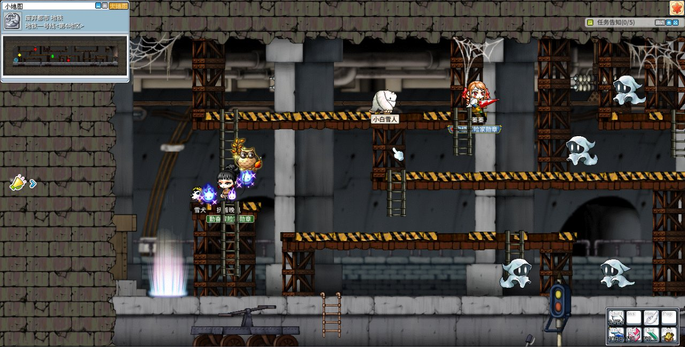

# 幽灵地图跨平台清怪方案

首版适配当前地铁幽灵图。角色在身边有可攻击目标时按住 S，清空后走到同平台的下一群怪，或通过已验证的梯子、绳子和下跳点换层。另设可选的跨平台狩猎模式，原地狩猎继续可选。本次交付为设计稿。

## 实机依据

截图来自 2732×1536 游戏客户区，归一化到 1280×720。图中截取上方 650 行。人物勋章连续三帧命中，攻击定位点约为 (430, 350)，脚下短平台的顶面约为 y=380。相同一帧使用当前 3 张幽灵模板及镜像，得到以下结果。耗时为本机预热一次后五次匹配的中位数，仅计怪物匹配。

| 搜索区域 | 识别数 | 幽灵中心坐标 | 单次耗时 |
|---|---:|---|---:|
| 当前人物周围，600×400 | 0 | — | 117 ms |
| 玩法区域，1280×650 | 4 | (1177,169)、(1090,282)、(962,511)、(1153,511) | 375 ms |

图中可见上方长平台、右侧中层、人物所在的左侧短平台、右下方平台和底部地面。约 x=430 和 x=740 处可见梯形结构。截图能确定位置和外形，入口是否够得着、短平台能否下穿、最终落在哪一层，需要通过动作和落点验证。不要把铁架、背景立柱或前景列车当成可通行结构。

## 1. 地图以平台段为单位

- 在 `maps/<地图>/` 保存地图参考和平台标注。每个平台记录 ID、可站立的横向区间及顶面折线。同一高度被空隙隔开的两段分别编号。每条有向连接记录起点平台、入口区间、终点平台、动作类型和出口范围。梯子和绳子共用攀爬动作；下跳单独标注，可以只许向下。首版只规划走路、攀爬和下跳。
- 首先标注截图可见范围，巡图后拼接相邻视野。选取刚性平台顶面及连接处作为地标，估计参考图和当前画面间的平移，用小地图人物点检查位移方向。排除人物、怪、背景视差和 UI。配准可信时才把画面坐标投到地图上；换图、尺寸异常或配准丢失时清掉旧目标和路线。
- 为人物单独标定从勋章到**脚底**的偏移。攻击使用已有角色中心坐标，判层使用脚底与平台顶面的距离，并要求横坐标落在该平台段。幽灵会浮动，使用检测框下沿到平台顶面的容差、水平重叠和连续观测归属平台。跨层歧义先标为未知。小地图黄点辅助检查进度，怪物位置来自游戏画面。

## 2. 感知与选目标

- 保留近场检测，优先处理最新帧和已标定的平台带。它负责判断角色当前能否出手。首版取同平台且中心落在人物周围 500×300 框内的幽灵，按住 S；离开范围、角色定位失效或切入移动时松开。若实测 S 能隔层命中，再将对应平台纳入技能可达规则。
- 远场扫描覆盖游戏玩法视野，屏蔽小地图、任务面板和底部 HUD。后台只保留一张待处理的最新帧，旧帧不排队。先用平台段缩小候选区域，再比较全尺寸匹配与低分辨率粗找、原尺寸确认的速度及漏检率。每批结果携带地图、帧号、时间和当时的画面偏移；过期结果丢弃。远场结果用于选路，抵达后由新近场结果确认攻击。
- 当前配置主循环目标 15 Hz，对应每轮约 67 ms；现有局部匹配本身已超过这个预算。首轮以回放记录近场停手延迟、远场结果年龄、CPU 占用和漏检率，再确定扫描频率。后台线程仍会争抢 CPU，须比较开启远扫前后的近场延迟。
- 决策顺序为当前能攻击的怪 → 当前可走平台上的怪 → 已知可达的其他平台 → 巡逻。跨层可在平台图上用最短路径，成本计入走到入口、爬升和下跳的时间。以怪群所在平台为目标，给当前路线短时间的优先权，避免上下两群怪交替被识别时反复折返。全屏无怪时沿当前平台的已知可走段向左右探索，再到最久未巡视的可达平台。屏幕外的位置是巡逻目的地，看到怪后才确认为目标。

## 3. 跨层动作状态机

| 状态或场景 | 按键顺序 | 完成依据 |
|---|---|---|
| 攻击 → 去入口或追同层目标 | 先松 S，再持有左或右；到目标范围松方向键 | 脚底到达入口区间，或近场检测确认目标已在射程 |
| 梯子正下方 | 对齐后松水平键，C 按下并松开，再按住上 | 在梯子横向范围内持续上移，超过单次跳跃的短暂上升，确认已挂梯 |
| 梯子侧面、角色已在可挂高度 | 先持有朝梯子的方向键，再叠加上；进入抓取区后松水平键、继续持有上 | 横向位置贴近梯子并沿梯持续上移。若低于可挂高度，先走到正下方，走跳抓分支 |
| 持续攀爬 → 上层 | 保持上。到达出口后由下一状态给出新的持键集合，统一释放上 | 脚底进入目标平台出口，并在后续新帧确认站稳。摄像机跟随时用地图相对位移 |
| 站台下跳 | 走到已验证的下跳区，松 S 和水平键；按住下，C 按下并松开，再松下 | 分别确认离开原平台、向下移动、在预期平台站稳。下落期间不重复发送 C |
| 恢复 | 松开本次动作持键，重新定位；若落在其他平台，从实际位置重新规划 | 挂梯失败可重新对齐再试；连续失败暂时排除这条连接，改选路线。失焦、暂停、断帧时取消在途按键 |

键盘线程当前只保存最新三段命令；两条发得太快的命令可能覆盖，普通组合命令也会先施加方向键、再点按动作。跨层动作应明确拆成阶段，每个点按携带一次性动作编号，键盘线程完成该阶段后回报编号。收到完成回报才进入下一按键阶段。物理移动成功仍由画面确认。感知帧不能覆盖尚未完成的 C 点按，恢复后也不能补发已经取消的动作。攀爬和下落过程中保留导航目标，稳定落地后再允许切入战斗。当前配置继承的跳跃键是 Alt，实施时在当前角色配置中明确设 `key.jump: c`。

## 4. 接入现有工程

| 位置 | 拟修改内容 |
|---|---|
| `src/engine/MonsterDetector.py` | 输出带时间戳的角色中心、脚底、小地图位置、近场怪及远场怪。现有 `Perception.monster_count` 只收到射程内数量，导航还需要各平台的观测。每次观测带有效标记，不能把上一次黄点当作新测量 |
| 地图与导航模块 | 读取平台图，进行配准、平台归属、选目标和路径计算，产出下一段路线。路线意外中断时根据已确认的平台恢复 |
| `src/engine/CharacterFSM.py` | 新模式负责追击、巡逻、接近入口、挂梯、攀爬、下跳和恢复。当前 `attack_in_place: true` 优先于搜索，新模式须显式选择；同一时刻只接受一个动作来源 |
| `src/input/KeyBoardController.py` | 复用现有持键差分和失焦松键，增加有序点按与阶段回报。普通移动、攻击继续使用现有命令接口 |
| `NewMaple` 监视窗口 | 显示脚底、当前平台、目标平台、下一处梯口或下跳点、可见怪数、射程内怪数、动作阶段和实际持键。回放和实机使用同一套标注 |

旧路线模块从 `minimaps/<name>` 加载彩色路线，仓库已有示例在 `maps/north_forest_training_ground_2`，当前路线开关关闭。它按颜色直接输出按键，还会依据上键指令累加估计高度。新地图首版使用独立的平台连接标注；旧路线数据有明确起终平台后才能参与寻路。

## 5. 实施与验收

1. **只读感知**。用本次截图及相邻视野回放，标注平台、玩家脚底和全屏幽灵。验收本帧应得到近场 0、玩法区 4；其他玩家、宠物和小地图图标不进入幽灵目标。测量静止、镜头滚动、列车遮挡下的平台归属。
2. **单连接实测**。选择一个梯口和一个下跳区，分别测试正下方跳抓、左右侧挂梯、爬出梯顶和下穿落地。记录真实输入顺序、动作编号及脚底轨迹。先测出抓取距离、跳跃持续时间、上下层高度和允许误差，再写入该地图配置。
3. **接入跨层清怪**。回放验证同层远怪会追、上层有怪会选可达梯口、下层有怪会走到有效下跳区、完全无怪会巡逻。任一时刻 S 仅在本地战斗条件满足时持有。另测目标途中消失、落错层、不可达目标及暂停恢复；确保松开 S、上、下、水平键，不重复跳或在同一个失败入口循环。
